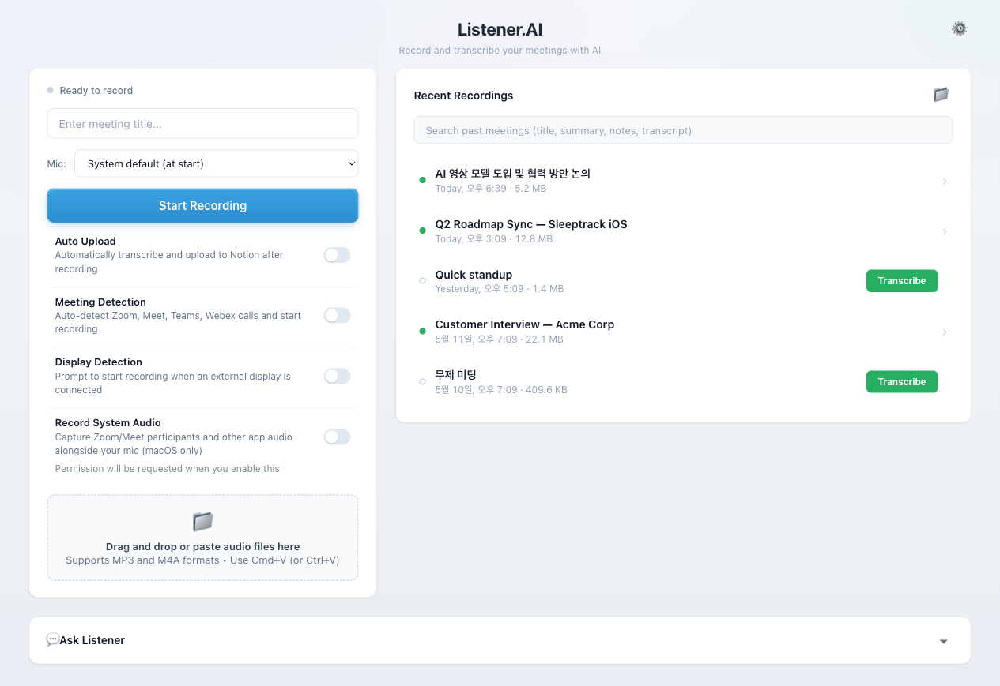
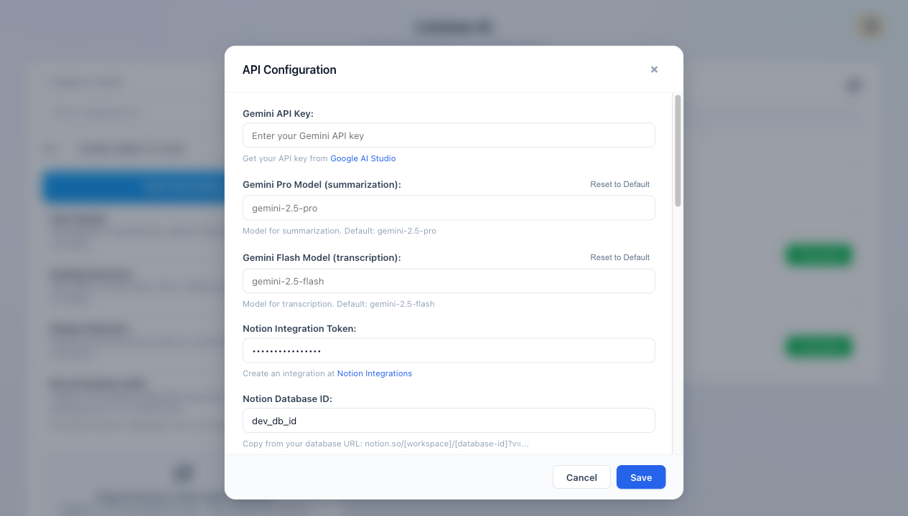

# Listener.AI

Listener.AI is a desktop meeting recorder and CLI that turns audio into searchable AI meeting notes. It records meetings, imports existing audio, transcribes with Gemini, generates agenda-based summaries and owner-grouped action items in the meeting's primary language, then keeps everything in a local archive you can send to Notion or Slack.

Available as a **desktop app** via [GitHub Releases](https://github.com/asleep-ai/listener-ai/releases) and as a **CLI tool** via npm.



## What It Does

1. Record a meeting from your microphone, or import an existing audio file.
2. Capture timestamped live highlights while the meeting is running.
3. Transcribe the audio and generate a structured meeting note.
4. Search, reopen, merge, export, or re-transcribe past recordings.
5. Share completed notes to Notion or Slack when your integrations are configured.

## Desktop App

Download from [GitHub Releases](https://github.com/asleep-ai/listener-ai/releases):

- **macOS**: Intel (x64) and Apple Silicon (arm64) DMG
- **Windows**: x64 installer

The desktop app includes:

- One-click recording with meeting title, mic selection, and elapsed timer
- Optional macOS system audio capture for Zoom, Meet, Teams, browser tabs, and other app audio
- Drag-and-drop or paste import for audio files
- Live highlights and timestamped flags during recording
- Recent recordings with search, transcript status, merge, Finder reveal, and M4A export actions
- Meeting detection and external display prompts for recording automation
- Automatic FFmpeg setup when transcription needs it
- Local configuration shared with the CLI



## CLI

### Install

```bash
npm install -g listener-ai
```

Or use directly:

```bash
npx listener-ai <audio-file>
```

### Prerequisites

- **Node.js >= 22.19** (the `@earendil-works/pi-ai` dependency requires it)
- **FFmpeg** installed on your system (`brew install ffmpeg` / `apt install ffmpeg`)
- One of:
  - **Google Gemini API key** from [Google AI Studio](https://makersuite.google.com/app/apikey), or
  - **ChatGPT Plus / Pro plan** (Sign in with ChatGPT) for summaries and Ask Listener, plus a separate transcription provider (Gemini key, OpenAI API key, or Soniox key) for recordings

### Setup

Pick one AI provider. Gemini uses a static API key and can also transcribe. ChatGPT uses your ChatGPT plan through the official Sign in with ChatGPT flow, but that flow cannot process audio, so transcribing recordings needs a separately billed transcription provider.

```bash
# Option A -- Gemini (summaries and transcription)
listener config set geminiApiKey <your-key>

# Option B -- ChatGPT plan for text, plus an explicit transcription provider
listener chatgpt login                 # browser sign-in (Continue with ChatGPT)
listener config set aiProvider chatgpt # sign-in alone does not switch providers
listener config set transcriptionProvider openai   # or gemini / soniox
listener config set openaiApiKey <your-openai-api-key>  # billed to your OpenAI API account
```

Optional Notion integration:

```bash
listener config set notionApiKey <your-key>
listener config set notionDatabaseId <your-id>
```

Optional Slack integration:

```bash
listener config set slackWebhookUrl <your-webhook-url>
listener config set slackAutoShare true  # Auto-share when auto mode is enabled
```

Optional live transcription streaming:

```bash
# Auto uses OpenAI Realtime with a direct OpenAI key, then Gemini Live,
# then 12-second chunked fallback.
listener config set liveSttProvider auto
# Required for OpenAI Realtime live translation. ChatGPT sign-in does not
# cover live captions.
listener config set openaiApiKey <your-openai-key>

# Optional BCP-47 source hint and translation target.
listener config set liveSttLanguage ko
listener config set liveTranslationLanguage ko
```

### Usage

```bash
listener recording.mp3                # Transcribe to the default output directory
listener recording.m4a --output ./    # Transcribe to the current directory
listener transcript recording.wav     # Print transcript to stdout without summary
listener transcript recording.wav -o out.txt
                                      # Write transcript to a file
listener transcript recording.wav --prompt "Translate to English while transcribing"
                                      # Override the default transcription instruction
listener list                         # List saved transcriptions
listener show <ref>                   # Print a saved meeting summary
listener search "roadmap"             # Search past meeting notes
listener export <ref> --transcript    # Export a saved note with transcript
listener merge <ref1> <ref2>          # Merge and re-transcribe multiple notes
listener ask "What did we decide?" --ref <ref>
                                      # Ask about a saved meeting
listener chatgpt login                # Sign in with ChatGPT (opens your browser)
listener chatgpt status               # Show ChatGPT connection, plan usage, and account
listener chatgpt logout               # Revoke and clear the ChatGPT sign-in
listener chatgpt models               # List the models your ChatGPT account offers
listener chatgpt accounts             # List signed-in ChatGPT accounts
listener chatgpt use <id>             # Switch the active ChatGPT account
listener config list                  # Show all config values with secrets masked
listener config get <key>             # Print one config value
listener config set <key> <value>     # Set a config value
listener config unset <key>           # Clear a config value
listener config path                  # Print config file path
listener --version                    # Print CLI version
listener --help                       # Show usage
```

Supported formats: mp3, m4a, wav, ogg, flac, aac, wma, opus, webm

Full meeting-note output is a folder containing `transcript.md` and `summary.md` with speaker identification, an agenda-based summary, key points, and owner-grouped action items in the meeting's primary language. Transcript-only output can print plain text to stdout or write directly to a file.

## Configuration

Config is stored in your system application data folder:

- **macOS**: `~/Library/Application Support/listener-ai/config.json`
- **Windows**: `%APPDATA%/listener-ai/config.json`
- **Linux**: `~/.config/listener-ai/config.json`

CLI and desktop app share the same config file. Existing installs that already have a `Listener.AI` data folder continue to use it when `listener-ai` is not present.

### Getting API Keys

#### Google Gemini API

1. Visit [Google AI Studio](https://makersuite.google.com/app/apikey)
2. Click "Create API Key"
3. Copy the generated key

#### Sign in with ChatGPT (ChatGPT Plus/Pro)

1. In the desktop app, open Settings -> AI connection, choose **ChatGPT plan** as the summary provider, and select **Continue with ChatGPT**. From the CLI, run `listener chatgpt login`, then `listener config set aiProvider chatgpt` (signing in does not switch providers).
2. Complete the browser sign-in and allow plan usage.
3. To transcribe recordings, choose a **Transcription service** under Settings -> Transcription and summary (Gemini, OpenAI API, or Soniox). The ChatGPT plan cannot transcribe audio, and `auto` refuses to pick a paid provider for you. Without one, ChatGPT still summarizes, regenerates reports, and answers questions about existing transcripts.

What runs on your ChatGPT plan: summaries, transcript quality checks, report regeneration, and Ask Listener. These share your plan's usage limits with your other apps. Use **Manage usage** (https://chatgpt.com/settings/usage) to check them.

What does not run on your ChatGPT plan: recording transcription and live captions. OpenAI's Sign in with ChatGPT documentation states that audio input and the transcription API are not supported by that flow. Transcription with **OpenAI API** uses a standard OpenAI API key (`openaiApiKey`) and is billed to your OpenAI API account; the default model is `gpt-4o-transcribe-diarize`, which labels speakers.

If you signed in but did not allow plan usage, Listener.AI keeps the sign-in but does not use your plan. Sign in again and allow it, or choose Gemini.

**Upgrading from the Codex provider.** Earlier versions offered a "Codex" provider that reused the Codex CLI sign-in. It has been removed. Your old settings stay in `config.json` but are not used, and the old tokens (including `~/.codex/auth.json`) are never read or reused. Sign in again with Continue with ChatGPT, and choose a transcription provider explicitly. If you used Codex transcription, select `openai` and add an OpenAI API key, or pick Gemini or Soniox. `listener codex login|status|logout` still work as deprecated aliases that forward to `listener chatgpt`.

#### Notion Integration

1. Go to [Notion Integrations](https://www.notion.so/my-integrations)
2. Create a new integration named "Listener.AI"
3. Grant permissions: Read, Insert, Update content
4. Copy the "Internal Integration Token"
5. Share your database with the integration
6. Get database ID from URL: `notion.so/workspace/DATABASE_ID`

#### Slack Integration

1. Create a Slack app with an Incoming Webhook.
2. Add the webhook to the channel where meeting notes should be posted.
3. Copy the webhook URL and save it with `listener config set slackWebhookUrl <url>`.

## Development

```bash
pnpm install
pnpm run start        # Run Electron app
pnpm run dev:renderer # Run renderer-only preview with sample data
pnpm run cli          # Run CLI locally
pnpm run dist:mac     # Build macOS
pnpm run dist:win     # Build Windows
```

## License

MIT
